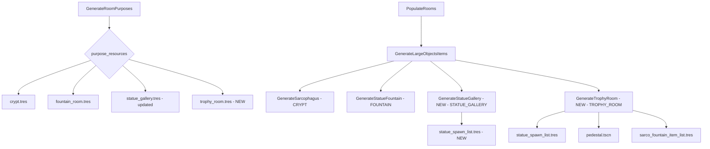

# Implementation Plan: Statue Gallery & Trophy Room Types

## Status Header (adjusted session 1)

Adjusted session 1 against the actual code on branch dev4. Original plan text is preserved below; only claims contradicted by code reality were corrected. No em-dashes used.

### Verified current state (evidence)

- FOUNTAIN: IMPLEMENTED. Enum entry at `scenes/worlds/world_gen/helper_objects/room_data.gd` line 13. Generation step exists: `scenes/worlds/world_gen/generation_steps/populate_room/generate_statue_fountain.gd` (queries `RoomData.OriginalPurpose.FOUNTAIN` at its line 43). Wired in `scenes/worlds/procedural_world/procedural_world.tscn` line 147 as node `GenerateStatueFountain`.
- STATUE_GALLERY: ENUM EXISTS, NOT GENERATED. Enum entry at `room_data.gd` line 14. A purpose resource exists: `scenes/worlds/world_gen/helper_objects/room_purposes/statue_gallery.tres` (purpose_id 3, max_amount 2, Min Size 6x6, Max Size 9x9, No Pillars, 1~99 Doorways). BUT it is NOT wired into `procedural_world.tscn`: line 129 shows `purpose_resources = [ExtResource("22"), ExtResource("7")]` (crypt and fountain only), and there is NO `GenerateStatueGallery` node under `GenerateLargeObjectsItems` (only `GenerateSarcophagus` at line 140 and `GenerateStatueFountain` at line 147). Grep for "statue|trophy" across `scenes/worlds/` finds no `generate_statue_gallery.gd` or any trophy generation step. Conclusion: STATUE_GALLERY rooms are never assigned and never populated at runtime.
- TROPHY_ROOM: ENUM EXISTS, NOTHING ELSE. Enum entry at `room_data.gd` line 17. No `.tres`, no generation step, no scene wiring, no assets. Zero trophy references outside the enum.
- Statue assets: all 8 planned statue scenes exist under `scenes/objects/large_objects/statuary/`: statue_angel_1, statue_angel_headless, statue_angel_headless_broken, statue_angel_mort, statue_gargoyle_1, statue_gargoyle_2, statue_gargoyle_2_broken, statue_gargoyle_3. So `statue_spawn_list.tres` can be built from existing assets as planned.
- Pedestal asset exists: `scenes/objects/large_objects/pedestal/pedestal.tscn`. Loot list exists: `scenes/worlds/procedural_world/sarco_fountain_item_list.tres`.
- Related but not room generation: `scenes/objects/large_objects/placement_anchor.gd` lines 54 and 93 define `STATUE` and `TROPHY_OR_CURIO` placement categories; not consumed by any room-purpose step.

### Contributor constraint

Kendarr (expected to deliver hero-asset rooms and possibly statue assets) may be unavailable. New hero/statue asset work therefore falls back to: (1) existing repo assets, (2) agent-made placeholders, or (3) contractors. This plan already uses only existing assets (8 statuary scenes, pedestal, loot list), so it is executable without Kendarr.

### Correction to the original plan's claim

The original plan said "No changes needed to room_data.gd" (original section 7). That claim is CORRECT as far as the enum goes: STATUE_GALLERY (value 3) and TROPHY_ROOM (value 6) already exist at `room_data.gd` lines 14 and 17. No enum edit is needed. The real gap is elsewhere: the existing `statue_gallery.tres` is not registered in `procedural_world.tscn` and no generation steps exist. Note that TROPHY_ROOM needs a NEW `trophy_room.tres` resource file (the enum alone does nothing).

---

## STATUE GALLERY: current state and remaining work

What already exists:
- Enum `STATUE_GALLERY = 3` at `room_data.gd` line 14 (nothing to add).
- `statue_gallery.tres` with purpose_id 3, max_amount 2, Min 6x6, Max 9x9, No Pillars, 1~99 Doorways.

What the plan adds (all still required):
1. Wire `statue_gallery.tres` into `GenerateRoomPurposes.purpose_resources` in `procedural_world.tscn` (it currently only lists crypt and fountain).
2. Create `statue_spawn_list.tres` from the 8 existing statuary scenes.
3. Create `generate_statue_gallery.gd` (no such step exists).
4. Add the `GenerateStatueGallery` node under `PopulateRooms/GenerateLargeObjectsItems`.
5. Per original plan: remove the No Pillars requirement sub_resource from `statue_gallery.tres` so pillar rooms qualify.

## TROPHY ROOM: new work

The enum exists per `room_data.gd` line 17, but NOTHING generates it: no resource file, no generation step, no scene node. TROPHY_ROOM is entirely new work: create `trophy_room.tres`, `generate_trophy_room.gd`, the scene node, and pedestal/statue wiring.

---

## Verify before building (do this first, statue state was uncertain)

1. Confirm `statue_gallery.tres` is absent from `purpose_resources` in `procedural_world.tscn` (as of this adjustment it is absent, line 129 lists only two resources).
2. Confirm no `generate_statue_gallery.gd` or `generate_trophy_room.gd` exists under `scenes/worlds/world_gen/generation_steps/`.
3. Confirm the 8 statuary scene paths listed below still exist under `scenes/objects/large_objects/statuary/`.
4. Confirm `pedestal.tscn` and `sarco_fountain_item_list.tres` paths.
5. Confirm `GenerateStatueFountain` node structure in `procedural_world.tscn` as the wiring pattern to copy (it references `room_purpose_data = ExtResource("7")`, the fountain purpose resource).
6. Check whether any other agent has touched these files since this adjustment; re-grep before editing.

---

## Original plan (design content preserved)

## Overview

Add two new room types to the procedural world generation system:
- **STATUE_GALLERY** (enum value 3, already exists in `OriginalPurpose`) — rooms with statues placed along walls and in the center, similar to crypt layout but with statues instead of sarcophagi
- **TROPHY_ROOM** (enum value 6, already exists in `OriginalPurpose`) — rooms with a pedestal in the center and 50/50 statue or pedestal along walls

## Key Design Decisions

| Aspect | Statue Gallery | Trophy Room |
|--------|---------------|-------------|
| Enum value | STATUE_GALLERY = 3 | TROPHY_ROOM = 6 |
| Size requirements | 6x6 min, 9x9 max | 6x6 min, 9x9 max |
| Doorways | 1-99 | 1-99 |
| Pillars | Allowed | Allowed |
| Max rooms | 2 | 1 |
| Center object | Random statue | Pedestal (always) |
| Wall objects | Statues (random) | 50/50 statue or pedestal |
| Object size | 1x1 cell with 1x1 clearance | 1x1 cell with 1x1 clearance |
| Spacing | Same as sarcophagi (2x2 grid spacing) | Same as sarcophagi (2x2 grid spacing) |
| Facing | Wall: away from wall; Center: toward doorway | Wall: away from wall; Center: toward doorway |
| Pedestal loot | N/A | sarco_fountain_item_list.tres |

## Architecture Diagram



## Placement Logic Flow

```mermaid
flowchart TD
    subgraph Statue Gallery
        SG1[Get STATUE_GALLERY rooms] --> SG2[For each room]
        SG2 --> SG3{4x4 room?}
        SG3 -->|Yes, 50% chance| SG4[Center-only placement]
        SG3 -->|No| SG5[Wall + Center placement]
        SG5 --> SG6[WallSegmentCellFilter - 2x2 spacing]
        SG6 --> SG7[Place random statue at each wall position]
        SG6 --> SG8[CenterCellFilter - center placement]
        SG8 --> SG9[Place random statue at center - face doorway]
        SG4 --> SG10[CenterCellFilter - center-only]
        SG10 --> SG9
    end
    
    subgraph Trophy Room
        TR1[Get TROPHY_ROOM rooms] --> TR2[For each room]
        TR2 --> TR3{4x4 room?}
        TR3 -->|Yes, 50% chance| TR4[Center-only placement]
        TR3 -->|No| TR5[Wall + Center placement]
        TR5 --> TR6[WallSegmentCellFilter - 2x2 spacing]
        TR6 --> TR7{50/50 roll}
        TR7 -->|Statue| TR8[Place random statue]
        TR7 -->|Pedestal| TR9[Place pedestal with loot]
        TR5 --> TR10[CenterCellFilter - center placement]
        TR10 --> TR11[Place pedestal at center - face doorway]
        TR4 --> TR12[CenterCellFilter - center-only]
        TR12 --> TR11
    end
```



## Files to Create/Modify

### 1. Update `statue_gallery.tres`
**Path:** `scenes/worlds/world_gen/helper_objects/room_purposes/statue_gallery.tres`

**Changes:** Remove the No Pillars requirement. Currently has 4 requirements including `has_pillars = false`. Remove that sub_resource so rooms with pillars can also be statue galleries.

Current requirements:
- Min Size 6x6 ✓
- Max Size 9x9 ✓
- No Pillars ✗ → REMOVE
- 1~99 Doorways ✓

### 2. Create `trophy_room.tres`
**Path:** `scenes/worlds/world_gen/helper_objects/room_purposes/trophy_room.tres`

New resource file with:
- purpose_id = 6 (TROPHY_ROOM)
- max_amount = 1
- Requirements: Min Size 6x6, Max Size 9x9, 1~99 Doorways (no pillar restriction, like fountain_room.tres)

### 3. Create `statue_spawn_list.tres`
**Path:** `scenes/worlds/procedural_world/statue_spawn_list.tres`

ObjectSpawnList resource containing all 8 statue scenes with equal weights:
- `res://scenes/objects/large_objects/statuary/statue_angel_1.tscn`
- `res://scenes/objects/large_objects/statuary/statue_angel_headless.tscn`
- `res://scenes/objects/large_objects/statuary/statue_angel_headless_broken.tscn`
- `res://scenes/objects/large_objects/statuary/statue_angel_mort.tscn`
- `res://scenes/objects/large_objects/statuary/statue_gargoyle_1.tscn`
- `res://scenes/objects/large_objects/statuary/statue_gargoyle_2.tscn`
- `res://scenes/objects/large_objects/statuary/statue_gargoyle_2_broken.tscn`
- `res://scenes/objects/large_objects/statuary/statue_gargoyle_3.tscn`

### 4. Create `generate_statue_gallery.gd`
**Path:** `scenes/worlds/world_gen/generation_steps/populate_room/generate_statue_gallery.gd`

Generation step for STATUE_GALLERY rooms. Key logic:

```
extends GenerationStep

Exports:
- statue_spawn_list: Resource (ObjectSpawnList)
- statue_tile_size := Vector2(2, 2)  # Use 2x2 for spacing like sarcophagi
- pedestal_scene_path for 1x1 placement offset
- vertical_center_rotation := 90

_execute_step(data, gen_data, generation_seed):
  1. Get rooms of type STATUE_GALLERY
  2. For each room:
     a. Check if 4x4 room with 50% chance for center-only
     b. If wall+center:
        - Use WallSegmentCellFilter with 2x2 object_size
        - For each wall segment position, place random statue at center of 2x2 area
        - Use CenterCellFilter for center statue
     c. If center-only:
        - Use CenterCellFilter for center statue
  3. Wall statues face away from wall (into room)
  4. Center statue faces a doorway
```

**Facing direction logic:**
- Wall statues: If on NORTH wall, face SOUTH. If on EAST wall, face WEST. Etc.
- Center statue: Pick a random doorway direction from the room and face that direction.

**Placement approach for 1x1 objects at 2x2 positions:**
- Use `WallSegmentCellFilter` with `object_size = Vector2(2, 2)` to get wall segment positions
- For each segment, calculate the center cell from the 2x2 group
- Place a 1x1 statue at that center position with appropriate offset
- Only set spawn data on the center cell, not all 4 cells of the 2x2 area

### 5. Create `generate_trophy_room.gd`
**Path:** `scenes/worlds/world_gen/generation_steps/populate_room/generate_trophy_room.gd`

Generation step for TROPHY_ROOM rooms. Key logic:

```
extends GenerationStep

Exports:
- statue_spawn_list: Resource (ObjectSpawnList)
- pedestal_scene_path: String (path to pedestal.tscn)
- item_spawn_list: Resource (for pedestal loot, references sarco_fountain_item_list.tres)
- statue_tile_size := Vector2(2, 2)
- vertical_center_rotation := 90

_execute_step(data, gen_data, generation_seed):
  1. Get rooms of type TROPHY_ROOM
  2. For each room:
     a. Check if 4x4 room with 50% chance for center-only
     b. If wall+center:
        - Use WallSegmentCellFilter with 2x2 object_size
        - For each wall segment position, 50/50 roll:
          - Statue: place random statue at center of 2x2 area
          - Pedestal: place pedestal at center of 2x2 area with loot
        - Use CenterCellFilter for center pedestal (always pedestal)
     c. If center-only:
        - Use CenterCellFilter for center pedestal
  3. Wall objects face away from wall
  4. Center pedestal faces a doorway
  5. Pedestals get loot items from item_spawn_list
```

### 6. Update `procedural_world.tscn`
**Path:** `scenes/worlds/procedural_world/procedural_world.tscn`

Changes:
- Add `statue_gallery.tres` and `trophy_room.tres` to `GenerateRoomPurposes.purpose_resources` array
- Add `GenerateStatueGallery` node under `PopulateRooms/GenerateLargeObjectsItems`
- Add `GenerateTrophyRoom` node under `PopulateRooms/GenerateLargeObjectsItems`
- Wire up the statue_spawn_list and other resources

### 7. No changes needed to `room_data.gd`
The `STATUE_GALLERY` (value 3) and `TROPHY_ROOM` (value 6) enum values already exist. No code changes needed.

### 8. No changes needed to `generate_room_purposes.gd`
The purpose_resources are configured via the scene inspector, not in code. The .tres files just need to be added to the array in the scene.

## Statue Facing Direction Mapping

| Wall Direction | Statue Facing | Y Rotation (radians) |
|---------------|--------------|---------------------|
| NORTH | South | PI |
| EAST | West | PI/2 |
| SOUTH | North | 0 |
| WEST | East | 3*PI/2 |

For center objects facing a doorway, use the doorway direction directly.

## Implementation Order

0. Run the "Verify before building" checklist above (statue state was uncertain at adjustment time; confirmed: enum exists, resource exists but unwired, no generation steps)
1. Update `statue_gallery.tres` (remove pillar restriction) AND add it to `purpose_resources` in `procedural_world.tscn` (it exists but is currently not registered)
2. Create `trophy_room.tres`
3. Create `statue_spawn_list.tres`
4. Create `generate_statue_gallery.gd`
5. Create `generate_trophy_room.gd`
6. Update `procedural_world.tscn` (remaining wiring: both Generate nodes)
7. Test and verify
